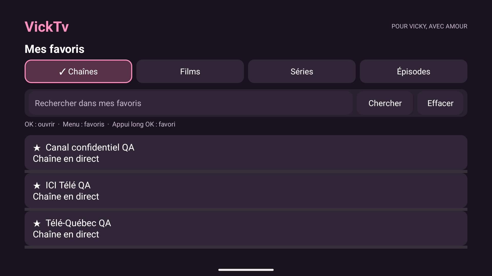
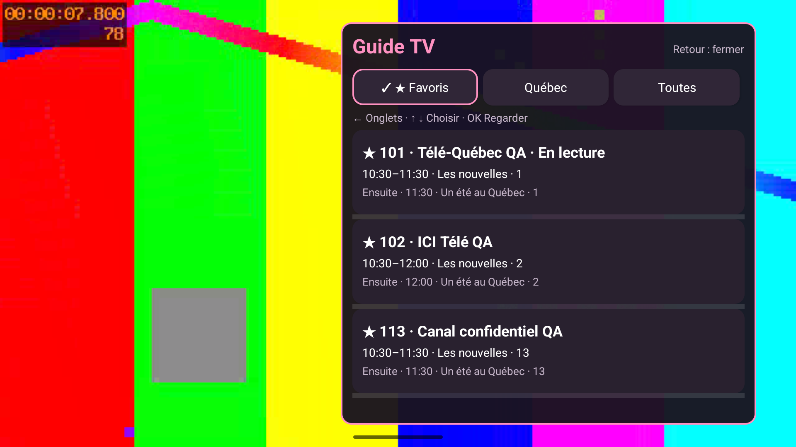
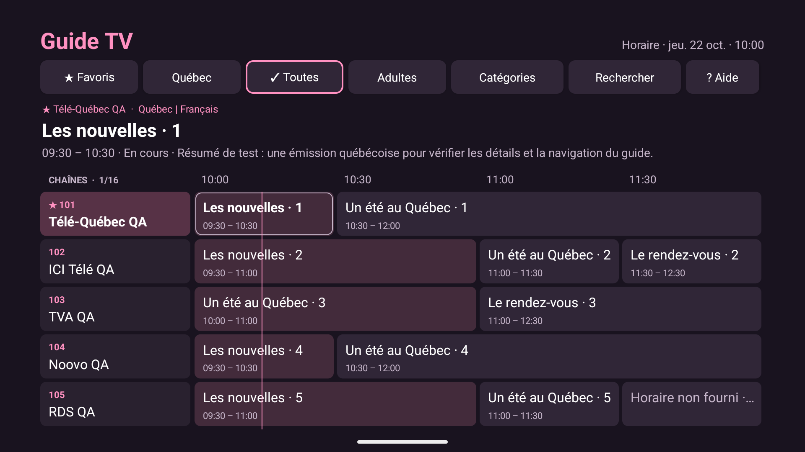
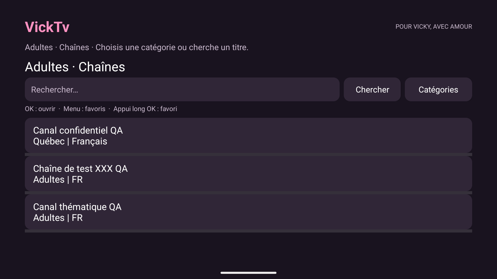
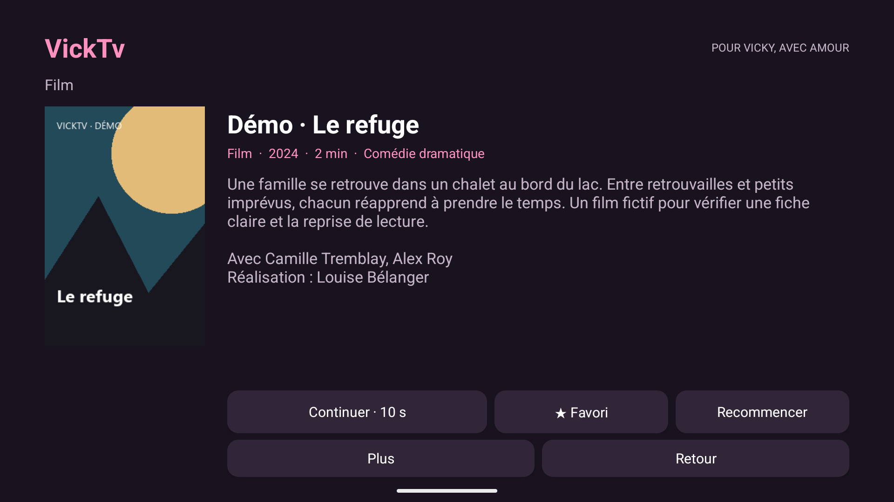
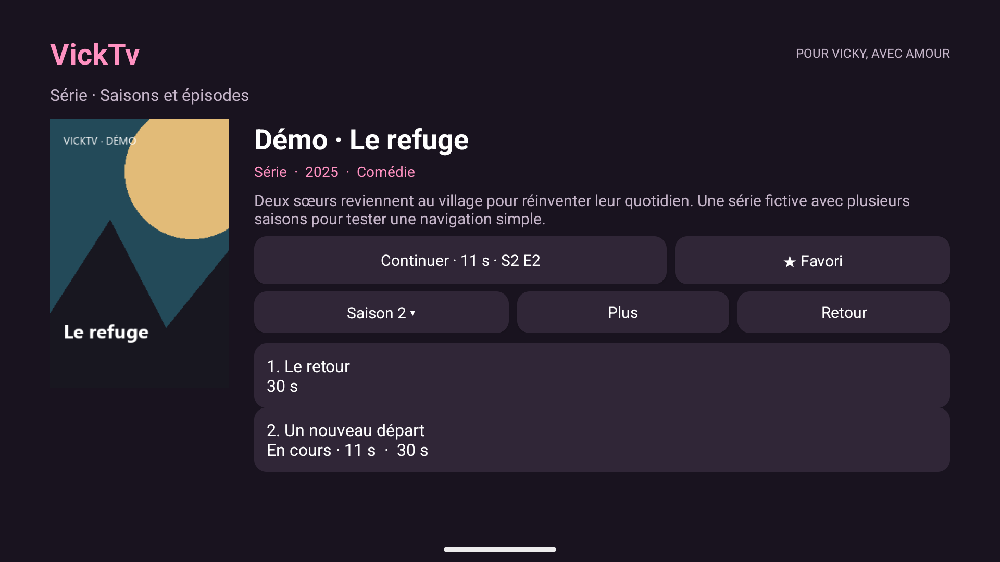
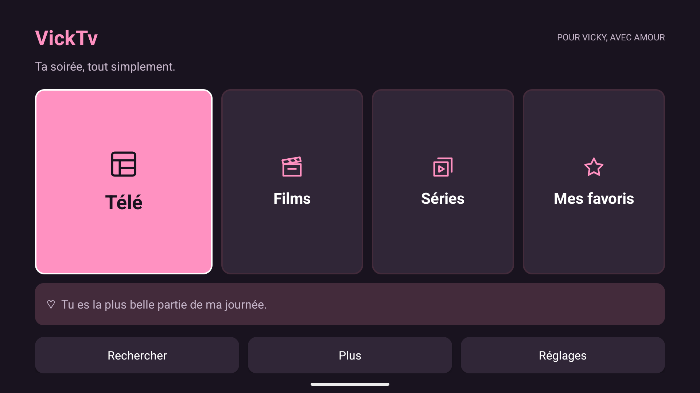

# VickTv

Un lecteur Xtream Codes personnel pour Fire TV, pensé pour Vicky : peu de menus, de gros boutons et un petit mot d’amour avant la soirée.

## Documentation du projet

Pour reprendre le travail : [référence technique, décisions et suivi](docs/DEVELOPPEMENT.md). Ce document central décrit l’architecture, l’état validé, les limites et les prochaines étapes.

## Version 0.8.1

**Mes favoris respire davantage.** Le titre est plus lisible, les onglets ont un état actif rose et la recherche est séparée par une vraie marge dans un panneau arrondi. La présentation est la même pour Chaînes, Films, Séries et Épisodes, y compris au retour d’une fiche. Les actions et les favoris enregistrés restent conservés.



**Changer de chaîne sans quitter sa vidéo.** Pendant le direct, **Menu** sur la télécommande ou le bouton **Guide TV** ouvre un mini-guide à droite, par-dessus la vidéo plein écran. **Favoris** est toujours le premier onglet; Québec et Toutes permettent de parcourir les autres chaînes. L’émission en cours et la suivante apparaissent lorsque le fournisseur donne l’horaire.

**↑ ↓** choisit une chaîne; **OK** la lance et ferme le panneau. **←** rejoint les onglets même depuis le bas de la liste; **↓** retrouve sa chaîne. Parcourir les chaînes ne change pas la lecture. **Retour** ferme simplement le mini-guide et retrouve la vidéo. La touche Son du lecteur reste disponible pour choisir l’audio; sur un film ou un épisode, Menu conserve son accès au son.

Les favoris enregistrés restent accessibles même si le catalogue du fournisseur ne répond pas. L’horaire absent n’empêche pas de regarder. Le mini-guide conserve des données en mémoire pendant la lecture; il ne remplace pas le guide complet accessible depuis Télé.



**Moins de boutons, plus de place aux chaînes.** Le guide retire Ajouter/Favori et Maintenant de son en-tête. La barre Options / Favoris disparaît des listes de chaînes et d’épisodes, y compris Adultes et leurs recherches. Ces actions restent accessibles avec Menu sur la télécommande; un appui long sur OK garde aussi l’ajout/retrait de favori dans les listes.





**Films et séries : de la pochette à la soirée, sans se perdre.** Une sélection ouvre maintenant une fiche : grande affiche, titre, résumé et renseignements fournis (année, durée, genre, distribution). Les champs absents ne sont pas inventés; un film peut toujours démarrer si sa fiche ne répond pas.

**Continuer** retrouve la position sauvegardée, même après fermeture complète ou mise à jour. **Recommencer** repart du début. Dans Films/Séries, le raccourci Continuer rejoint le titre récent; Tout reprendre présente les autres pochettes en cours. La reprise est enregistrée à partir de quelques secondes de lecture et dépend du déplacement temporel permis par le flux.

Les séries ont un bouton **Saison**, une liste d’épisodes numérotés et des repères **Vu / En cours**. La fiche propose le bon épisode à reprendre. À la fin, **Épisode suivant** peut passer à la saison suivante; rien ne démarre automatiquement. Le menu d’un épisode permet de corriger son état Vu et de lire son résumé.

**Mes favoris** propose Chaînes, Films, Séries et Épisodes. Les anciens favoris sont conservés avec leurs identifiants et restent accessibles; les anciens épisodes sans lien de série se lisent directement. Les favoris et les positions sont propres au compte de chaque téléviseur.

Le catalogue Films/Séries reste **en français, de toutes origines**, sans filtre de langue à choisir. Recherche contextualisée, bouton Effacer et pochettes de remplacement sont conservés. Les renseignements et le classement dépendent du fournisseur.

L’accueil garde Télé, Films, Séries et Mes favoris; Sports et Adultes sont sous Plus. Le guide garde Favoris en premier et son retour au menu avec Retour. Les marges TV restent de 5 %, ou 8 % dans Réglages → Image coupée sur les bords. Les petits mots restent dans une carte non bloquante.

**Installer par-dessus la version actuelle, sans désinstaller.** Le paquet et la signature sont identiques. Les comptes, favoris, préférences et 50 petits mots en rotation restent conservés. L’historique local garde les 200 derniers films/épisodes par compte; il ne se synchronise pas entre les TV. Les versions antérieures à 0.7.0 ne sauvegardaient pas les positions.







## Le guide, en trois gestes

1. À l’accueil, choisir **Télé**. **↑ ↓** change de chaîne; **← →** parcourt les émissions et les heures suivantes.
2. **OK** regarde la chaîne si l’émission est en cours. Sur une émission à venir, OK ouvre les détails et propose de regarder la chaîne **en direct**.
3. Après la lecture, **Retour** retrouve sa place dans le guide. Dans la grille, **Retour** rejoint les onglets du haut; **↓** retrouve la chaîne sélectionnée. Un autre **Retour**, depuis les onglets, ramène à l’accueil.

Pour garder une chaîne : **Menu → Ajouter aux favoris**. Une étoile près du nom indique qu’elle est déjà gardée. **★ Favoris** ne montre ensuite que ces chaînes. **Menu → Revenir à maintenant** rejoint l’horaire courant. Menu donne aussi accès à **Favoris / Québec / Toutes** et à la recherche, depuis n’importe quelle ligne. **? Aide** explique les commandes dans l’application.

**Rechercher** trouve un nom ou un numéro dans la sélection actuelle. Choisir **Toutes**, puis **Rechercher → Tout effacer** pour repartir de toutes les chaînes. **Catégories** reprend les groupes du fournisseur. À la première ouverture, le guide sélectionne toujours ★ Favoris. Si la liste est vide, choisir Toutes, puis ajouter une chaîne avec Menu. Les retours conservent la sélection précédente; ouvrir le guide depuis une chaîne montre cette chaîne dans Toutes.

Sans compte, le guide montre un **horaire de démonstration fictif**, clairement identifié. Avec un compte, les titres et descriptions viennent uniquement du fournisseur. Une chaîne sans horaire reste accessible avec OK; une case vide n’invente aucune émission. Il n’y a ni enregistrement, ni rattrapage, ni guide sur plusieurs jours.

## Première installation

1. Télécharger **VickTV.apk** dans [Releases](https://github.com/kcote84/VickTV/releases).
2. Transférer l’APK sur le Fire Stick (par exemple avec un outil de transfert de fichiers) ou utiliser Downloader lorsque le lien de téléchargement est public.
3. Autoriser cette source d’installation dans **Ma Fire TV → Options développeur → Installer des applications inconnues**. Le libellé varie selon Fire OS.
4. Installer puis ouvrir VickTV. Le mode démo fonctionne sans compte.
5. Dans **Réglages → Connecter mon compte**, entrer l’URL du serveur, l’utilisateur et le mot de passe. Refaire sur la deuxième TV avec son deuxième compte.

**Compatibilité :** Android 8+ / Fire OS 7+. Les Fire Stick sous Vega OS ne peuvent pas installer cet APK. Modèles exacts des deux appareils à confirmer avant validation.

## Navigation

- Flèches : naviguer; OK : ouvrir ou regarder; Retour : revenir.
- Accueil : Télé, Films, Séries, Mes favoris; Rechercher, Plus et Réglages. Sports et Adultes 18+ sont sous Plus.
- Les regroupements Québec/Sports utilisent les noms des catégories et chaînes du fournisseur; ils peuvent être imparfaits. Le bouton **Catégories** dans le direct donne accès aux groupes originaux.
- Appui long sur OK dans une liste : ajouter/retirer un favori.
- Pendant la lecture : **Son** ou touche Menu de la télécommande pour choisir une piste.
- **Sous-titres** se choisit dans le lecteur; **Plus** regroupe vitesse, détails du flux et Réessayer. Les détails décrivent le flux reçu, sans mesurer la sortie HDMI.
- Réglages → Son propose la préférence stéréo/5.1; Options avancées contient le format MPEG-TS/HLS.

Le choix du son utilise les pistes reçues. L’audiodescription est évitée par défaut lorsqu’une autre piste est disponible; une narration déjà mélangée à l’unique piste ne peut pas être retirée. La sortie stéréo/5.1 dépend aussi de la télé et du Fire Stick.

## Films et séries, en trois gestes

1. Choisir une pochette, puis **Regarder** ou **Continuer** sur sa fiche.
2. Pour une série, choisir **Saison**, puis l’épisode voulu. Retour après la lecture retrouve cette saison.
3. Utiliser **Recommencer** pour repartir du début; dans Plus, l’état Vu peut être corrigé et une entrée retirée de Continuer sans retirer son favori.

La position est sauvegardée toutes les 5 secondes pendant la lecture, à la pause et à la sortie. Un arrêt brutal peut perdre les dernières secondes. La fin réelle ou les derniers 5 % (au maximum 90 secondes) donnent le repère Vu. Cette règle évite de garder indéfiniment un générique dans Continuer.

## Les petits mots

50 messages français distincts, dans un ordre tournant conservé sur chaque appareil. Ils apparaissent dans une carte non bloquante au lancement et au retour dans l’app lorsque l’accueil est visible. Allumer uniquement le téléviseur ne garantit pas que Fire OS ouvre VickTV; aucun démarrage automatique du téléviseur n’est intercepté. Option désactivable dans Réglages.

## Comptes et confidentialité

Chaque Fire Stick garde son propre compte Xtream, chiffré avec Android Keystore. Aucune donnée du fournisseur n’est incluse dans le code, dans GitHub ou dans les APK. Pas de télémétrie. Un serveur HTTP transmet toutefois ses données sans chiffrement réseau; préférer HTTPS lorsque disponible. Ne jamais ajouter de vrais identifiants au dépôt.

## Mises à jour

Dans **Réglages → Mise à jour**, l’app lit `update.json` dans la dernière release stable de `kcote84/VickTV`, puis propose le téléchargement et l’installateur système. Validation SHA-256, nom du paquet, version et certificat avant ouverture de l’installateur. Garder la même clé de signature à chaque version.

**Le dépôt et les APK sont publics depuis le 21 octobre 2026.** Le téléchargement et l’accès au manifeste de mise à jour ne demandent donc pas de compte GitHub. Aucune clé GitHub n’est embarquée dans l’APK. L’installation et la mise à jour sur Fire Stick restent à valider sur les appareils réels.

## Développement

Kotlin + vues Android natives + AndroidX Media3 ExoPlayer. Java 17, Android SDK 35, Gradle 8.9. Dépendances épinglées, base volontairement simple.

```sh
./gradlew testDebugUnitTest lintDebug assembleDebug
```

La signature release utilise `VICKTV_KEYSTORE`, `VICKTV_STORE_PASSWORD` et `VICKTV_KEY_PASSWORD`, alias `vicktv`. Le fichier de clé reste hors Git. Les builds debug servent aux essais uniquement : leur signature est différente de la release.

L’APK signé à publier est transféré en morceaux dans `distribution/` et un workflow le reconstruit dans GitHub Releases. Les mises à jour préparées localement peuvent suivre le même chemin, sans transmettre la clé de signature à GitHub. GitHub Actions comprend aussi la vérification des sources et une option de compilation signée. Pour activer la publication automatique, ajouter les trois secrets décrits dans [docs/DEVELOPPEMENT.md](docs/DEVELOPPEMENT.md), augmenter `versionCode` et `versionName`, puis pousser le tag correspondant.

## Limites du MVP

Voir les [notes de version](docs/RELEASE_NOTES.md). Compilation et tests automatisés ne remplacent pas les essais de télécommande, de lecture Xtream et de 5.1 sur Fire Stick réel.
