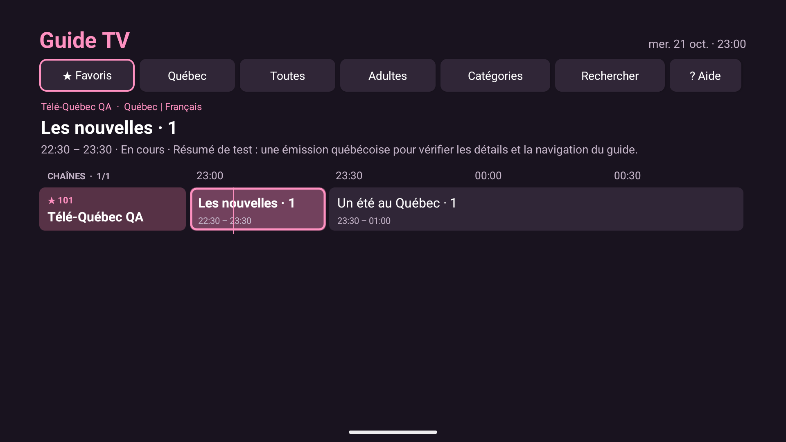
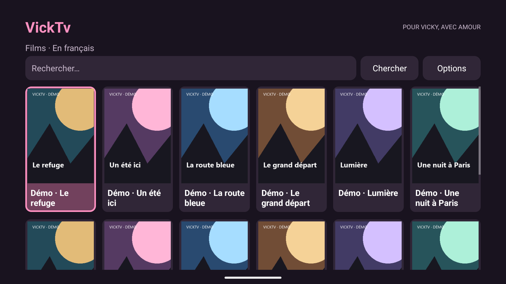

# VickTv

Un lecteur Xtream Codes personnel pour Fire TV, pensé pour Vicky : peu de menus, de gros boutons et un petit mot d’amour avant la soirée.

## Documentation du projet

Pour reprendre le travail : [référence technique, décisions et suivi](docs/DEVELOPPEMENT.md). Ce document central décrit l’architecture, l’état validé, les limites et les prochaines étapes.

## Version 0.5.2

La version **0.5.2 (code 11)** permet de rejoindre les onglets du haut avec **Retour**, depuis n’importe quelle chaîne du guide. La chaîne, le défilement et l’heure restent à la même place; **↓** revient dans la grille. Depuis les onglets, **Retour** ramène à l’accueil.

La roue rose et le filtrage en arrière-plan de 0.5.1 sont conservés. Les favoris et le compte restent présents lors d’une mise à jour sur place.

[Aperçu de la transition de chargement](docs/images/guide-chargement.png).

La bordure de sécurité autour des boutons reste de **5 %**, ou **8 %** dans **Réglages → Bordure TV** pour une télé qui rogne davantage l’image.

Le guide commence par **★ Favoris**. Le raccourci **Québec** du guide et de l’accueil sélectionne les chaînes locales francophones reconnues; **Direct** et **Toutes** conservent le catalogue complet.

**Films** et **Séries** affichent des galeries de pochettes avec recherche et favoris. Le catalogue est directement en français, de France, du Québec ou doublé, sans filtres à choisir. Les titres indiqués VOSTFR sont exclus. Le classement dépend des noms du fournisseur et ne vérifie pas les pistes audio de chaque œuvre. Une pochette absente garde un pictogramme et son titre.

Pendant la lecture, les commandes se superposent à l’image plein écran sans la réduire. Les réglages audio et les mises à jour restent dans **Réglages**. La narration intégrée à une unique piste fournie ne peut pas être retirée par l’application.

**Adultes 18+** reste disponible à l’accueil et dans le guide. Le regroupement utilise les métadonnées Xtream et ne constitue pas un contrôle parental.






## Le guide, en trois gestes

1. À l’accueil, choisir **Guide TV**. **↑ ↓** change de chaîne; **← →** parcourt les émissions et les heures suivantes.
2. **OK** regarde la chaîne si l’émission est en cours. Sur une émission à venir, OK ouvre les détails et propose de regarder la chaîne **en direct**.
3. Après la lecture, **Retour** retrouve sa place dans le guide. Dans la grille, **Retour** rejoint les onglets du haut; **↓** retrouve la chaîne sélectionnée. Un autre **Retour**, depuis les onglets, ramène à l’accueil.

Pour garder une chaîne : **Menu → Ajouter aux favoris**. **★ Favoris** ne montre ensuite que ces chaînes. Menu donne aussi accès à **Favoris / Québec / Toutes**, à la recherche et à **Revenir à maintenant**, depuis n’importe quelle ligne. **? Aide** explique les commandes dans l’application.

**Rechercher** trouve un nom ou un numéro dans la sélection actuelle. Choisir **Toutes**, puis **Rechercher → Tout effacer** pour repartir de toutes les chaînes. **Catégories** reprend les groupes du fournisseur. À la première ouverture, le guide sélectionne toujours ★ Favoris. Si la liste est vide, choisir Toutes, puis ajouter une chaîne avec Menu. Les retours conservent la sélection précédente; ouvrir le guide depuis une chaîne montre cette chaîne dans Toutes.

Sans compte, le guide montre un **horaire de démonstration fictif**, clairement identifié. Avec un compte, les titres et descriptions viennent uniquement du fournisseur. Une chaîne sans horaire reste accessible avec OK; une case vide n’invente aucune émission. Il n’y a ni enregistrement, ni rattrapage, ni guide sur plusieurs jours.

## Première installation

1. Télécharger **VickTV.apk** dans [Releases](https://github.com/kcote84/VickTV/releases).
2. Transférer l’APK sur le Fire Stick (par exemple avec un outil de transfert de fichiers) ou utiliser Downloader lorsque le lien de téléchargement est public.
3. Autoriser cette source d’installation dans **Ma Fire TV → Options développeur → Installer des applications inconnues**. Le libellé varie selon Fire OS.
4. Installer puis ouvrir VickTV. Le mode démo fonctionne sans compte.
5. Dans **Réglages → Connecter mon compte Xtream**, entrer l’URL du serveur, l’utilisateur et le mot de passe. Refaire sur la deuxième TV avec son deuxième compte.

**Compatibilité :** Android 8+ / Fire OS 7+. Les Fire Stick sous Vega OS ne peuvent pas installer cet APK. Modèles exacts des deux appareils à confirmer avant validation.

## Navigation

- Flèches : naviguer; OK : ouvrir ou regarder; Retour : revenir.
- Accueil : Guide TV, Favoris, Direct, Films, Séries, Québec, Sports, Adultes 18+ et Réglages.
- Les regroupements Québec/Sports utilisent les noms des catégories et chaînes du fournisseur; ils peuvent être imparfaits. Le bouton **Catégories** dans le direct donne accès aux groupes originaux.
- Appui long sur OK dans une liste : ajouter/retirer un favori.
- Pendant la lecture : **Audio / Son** ou touche Menu de la télécommande pour choisir une piste.
- **Infos** décrit le flux reçu, sans prétendre mesurer la sortie HDMI.
- Le menu Réglages propose le direct MPEG-TS/HLS et la préférence pour une piste stéréo disponible.

## Les petits mots

50 messages français distincts, dans un ordre tournant conservé sur chaque appareil. Ils apparaissent au lancement et au retour dans l’app lorsque l’accueil est visible. Allumer uniquement le téléviseur ne garantit pas que Fire OS ouvre VickTV; aucun démarrage automatique du téléviseur n’est intercepté. Option désactivable dans Réglages.

## Comptes et confidentialité

Chaque Fire Stick garde son propre compte Xtream, chiffré avec Android Keystore. Aucune donnée du fournisseur n’est incluse dans le code, dans GitHub ou dans les APK. Pas de télémétrie. Un serveur HTTP transmet toutefois ses données sans chiffrement réseau; préférer HTTPS lorsque disponible. Ne jamais ajouter de vrais identifiants au dépôt.

## Mises à jour

Dans **Réglages → Vérifier les mises à jour**, l’app lit `update.json` dans la dernière release stable de `kcote84/VickTV`, puis propose le téléchargement et l’installateur système. Validation SHA-256, nom du paquet, version et certificat avant ouverture de l’installateur. Garder la même clé de signature à chaque version.

**Le dépôt et les APK sont publics depuis le 21 octobre 2026.** Le téléchargement et l’accès au manifeste de mise à jour ne demandent donc pas de compte GitHub. Aucune clé GitHub n’est embarquée dans l’APK. L’installation et la mise à jour sur Fire Stick restent à valider sur les appareils réels.

## Développement

Kotlin + vues Android natives + AndroidX Media3 ExoPlayer. Java 17, Android SDK 35, Gradle 8.9. Dépendances épinglées, base volontairement simple.

```sh
./gradlew testDebugUnitTest lintDebug assembleDebug
```

La signature release utilise `VICKTV_KEYSTORE`, `VICKTV_STORE_PASSWORD` et `VICKTV_KEY_PASSWORD`, alias `vicktv`. Le fichier de clé reste hors Git. Les builds debug servent aux essais uniquement : leur signature est différente de la release.

L’APK signé à publier est transféré en morceaux dans `distribution/` et un workflow le reconstruit dans GitHub Releases. Les mises à jour préparées localement peuvent suivre le même chemin, sans transmettre la clé de signature à GitHub. GitHub Actions comprend aussi la vérification des sources et une option de compilation signée. Pour activer la publication automatique, ajouter les trois secrets décrits dans [docs/DEVELOPPEMENT.md](docs/DEVELOPPEMENT.md), augmenter `versionCode` et `versionName`, puis pousser le tag correspondant.

## Limites du MVP

Voir les [notes de version](docs/RELEASE_NOTES.md). Compilation et tests automatisés ne remplacent pas les essais de télécommande, de lecture Xtream et de 5.1 sur Fire Stick réel.
